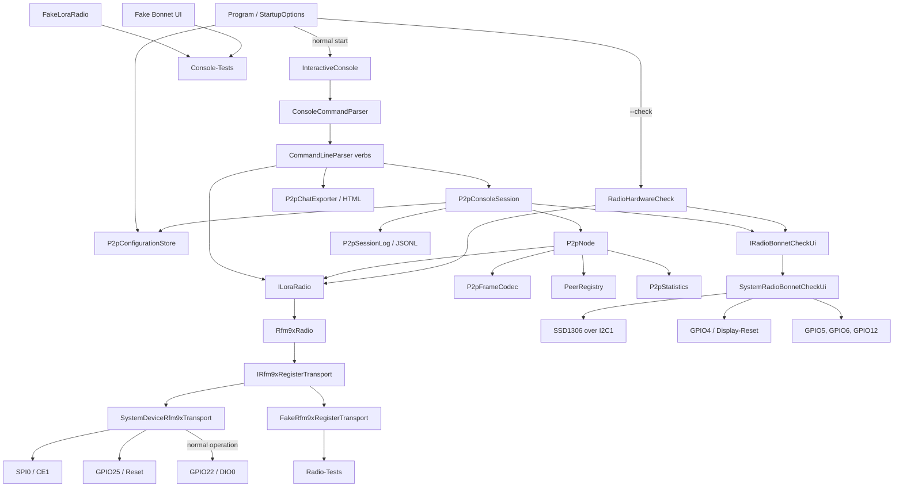

# Product Requirements Document: RFM95 Radio Client as LoRaWAN Foundation

## 1. Document status

| Field | Value |
| --- | --- |
| Product | LoRaP2P Console |
| Version | 1.0 (Raw LoRa PoC) |
| Status | Implemented, hardware validation pending |
| Target platform | Raspberry Pi 3B+, Raspberry Pi OS 64-bit, .NET 10 |
| Radio hardware | Adafruit LoRa Radio Bonnet, RFM95W 868/915 MHz |
| Operating region | Germany / EU868 |

## 2. Background

An Adafruit LoRa Radio Bonnet on a Raspberry Pi 3B+ is to be controlled through a .NET 10 console application. `KiwiBryn/RFM9XLoRa-Net` serves as the technical reference. That project contains useful SX1276/RFM95 register and FIFO logic, but is based on archived UWP APIs and implements only Raw LoRa, not LoRaWAN.

Version 1 therefore first validates direct SPI/GPIO access and radio operation.

## 3. Product goal

Provide a testable .NET 10 RFM95 driver and interactive console that lets developers:

- detect and configure the RFM95W over SPI0/CE1,
- validate EU868-compliant PoC parameters,
- send and receive Raw LoRa payloads,
- diagnose registers and radio status,
- verify driver behavior with NUnit without Raspberry Pi hardware

## 4. Version 1 non-goals

- No LoRaWAN OTAA or ABP
- No LoRaWAN encryption, MIC calculation, or session keys
- No ADR or MAC command processing
- No persistent frame counters or nonces
- No LoRaWAN gateway or network server
- No microphone or speech recognition in the radio client; the separate
  `LoRaP2P.SpeechDisplay` uses only the microphone and OLED.
- No systemd service or unattended sensor application
- No confirmation of radio reception with only one transceiver

## 5. Users and use cases

### Primary user

Developer or maker with C#/.NET experience, Raspberry Pi 3B+, and Adafruit RFM95W Bonnet.

### Core flows

1. User enables SPI, starts the application, and receives successful chip detection (`0x12`).
2. User checks the active EU868 profile and selected SX1276 registers.
3. User sends a text or hexadecimal payload and sees `TxDone` and time-on-air.
4. User waits for a Raw LoRa packet with a configurable timeout.
5. User changes frequency, spreading factor, bandwidth, or power within the permitted limits.
6. Developer runs all driver tests on a Windows computer without radio hardware.

## 6. Hardware and platform requirements

| Function | Assignment |
| --- | --- |
| SPI-Bus | SPI0 |
| Chip Select | CE1 / Chip-Select 1 |
| Reset | BCM GPIO25, active Low |
| DIO0 / IRQ | BCM GPIO22, rising edge |
| DIO1 | BCM GPIO23, not used in version 1 |
| DIO2 | BCM GPIO24, not used in version 1 |
| Operating system | Raspberry Pi OS 64-bit |
| Runtime | self-contained `linux-arm64` publish of .NET 10 |

An antenna tuned to 868 MHz must be connected before every transmission attempt. Although the RFM95W supports 868 and 915 MHz in software, this product uses EU868 defaults exclusively in Germany.

## 7. Functional requirements

### FR-001: Configuration

- Application MUST load configuration from `appsettings.json`.
- An alternative path MUST be available through `--config <path>`.
- `--check` MUST verify reset, SPI communication, chip version, configuration,
  standby status, OLED, and the three Bonnet buttons, and continue until
  interrupted.
- Default profile MUST use 869.525 MHz, SF7, BW125, CR 4/5, payload CRC,
  sync word `0x34`, 14 dBm, and 10% duty cycle.
- Frequencies outside 863 to 870 MHz MUST be rejected.
- Transmission power outside 2 to 17 dBm MUST be rejected.
- Reset and DIO0 pins MUST be different and non-negative.
- Field semantics, ranges, interactions, and regulatory limits are described in
  the [radio configuration documentation](radio-configuration.md).

### FR-002: Hardware transport

- SPI MUST use mode 0, 8 data bits, 5 MHz, and hardware chip select.
- Register reads MUST use full-duplex transfers with an address byte and dummy bytes.
- Register writes MUST set the address write bit.
- Concurrent SPI transfers MUST be serialized.
- DIO0 callbacks MUST NOT perform SPI operations; they only signal the waiting operation.

### FR-003: Reset and probe

- Reset MUST set GPIO25 Low for at least 1 ms and then allow at least 5 ms for initialization.
- Probe MUST read register `0x42`.
- Only value `0x12` counts as a detected SX1276/RFM95.
- Deviations MUST produce an understandable error message.

### FR-004: Radio configuration

- Driver MUST set frequency, PA, LNA, modem, preamble, CRC, IQ, and sync word registers.
- Configuration MUST begin in sleep mode and end in standby mode.
- Low-data-rate optimization MUST be set based on symbol duration.

### FR-005: Transmission

- Payload length MUST be 1 to 255 bytes.
- FIFO address, payload, and payload length MUST be set before TX.
- DIO0 MUST be mapped to `TxDone`.
- TX MUST be cancellable through timeout and cancellation.
- After success or failure, the radio MUST return to standby.
- Success output MUST be named `TxDone` and must not claim reception by a peer.
- Time-on-air and a conservative transmission pause according to the configured duty cycle MUST be calculated.

### FR-006: Reception

- Application MUST be able to start a single reception with a timeout.
- DIO0 MUST be mapped to `RxDone`.
- Payload MUST be read through `FifoRxCurrentAddress` and `RxByteCount`.
- CRC status, packet RSSI, and packet SNR MUST be output.
- A timeout MUST end without an unhandled error.
- After completion, the radio MUST return to standby.

### FR-007: Interactive console

The following commands MUST be available:

| Command | Behavior |
| --- | --- |
| `probe` | Check chip version |
| `status` | Show mode, IRQ, and radio profile |
| `reset` | Reset hardware and reapply profile |
| `configure frequency <MHz>` | Set EU868 frequency |
| `configure sf <7-12>` | Set spreading factor |
| `configure bandwidth <125\|250\|500>` | Set bandwidth |
| `configure power <2-17>` | Set power |
| `send text <value>` | Send UTF-8 payload |
| `send hex <bytes>` | Send binary payload |
| `receive [seconds]` | Wait for a packet or timeout |
| `register read <address> [count]` | Read registers |
| `register dump` | Show registers `0x01` through `0x42` |
| `quit` | Exit the application cleanly |

 A generic register-write function is intentionally not part of the normal CLI, to avoid accidental invalid radio configurations.

## 8. Nonfunctional requirements

### Separate speech CLI

`src/LoRaP2P.SpeechDisplay` captures speech through an external ALSA microphone
and recognizes it locally with Vosk. Confirmed text segments are wrapped and
scrolled upward line by line on the Bonnet OLED. New segments are appended. The
tool accesses neither SPI nor `ILoraRadio`. Without a local `--model` override,
the model ZIP selected by `--model-url` is automatically downloaded to the user
directory and cached for later offline starts. The default is
`vosk-model-small-de-0.15` from the Vosk provider.

`src/LoRaP2P.Display.RadioBonnet` encapsulates shared SSD1306 control, GPIO4
reset, font, framebuffer, and text layout. The radio console and speech CLI use
this project; buttons and broadcast scroll control remain in the radio console.
Both programs must not use the same display simultaneously. Setup and hardware
checks are documented in
[speech-display.md](speech-display.md).

### NFR-001: Testability

- Radio state machine MUST depend exclusively on `IRfm9xRegisterTransport`.
- Console commands MUST be testable exclusively through `ILoraRadio`.
- Unit tests MUST run without GPIO, SPI, or Raspberry Pi.
- NUnit 5.0.0, NUnit3TestAdapter 6.3.1, and Microsoft.NET.Test.Sdk 18.10.1
  are used. NuGet versions are centrally managed in `Directory.Packages.props`.

### NFR-002: Robustness

- No radio operation may block indefinitely.
- Cancellation and timeout must restore radio state.
- Transport and radio must be released deterministically.
- SPI access must not occur in parallel.

### NFR-003: Security

- Version 1 contains no keys or secrets.
- Future AppKeys must not be stored in the repository, logs, or default JSON.
- Operation should use `spi` and `gpio` groups, not run permanently as root.

### NFR-004: Maintainability

- Hardware transport, RFM95 driver, console UI, and tests remain separate.
- `ILoraRadio` contains no LoRaWAN-specific types.
- Build warnings are treated as errors.

## 9. Architecture

## 10. Acceptance criteria

### Without hardware

- `dotnet restore` succeeds.
- `dotnet build LoRaP2P.slnx --configuration Release` succeeds without warnings.
- `dotnet test LoRaP2P.slnx --configuration Release` runs all NUnit tests successfully.
- Command parsing and all verbs are tested without radio hardware.
- Frequency conversion, EU868 validation, time-on-air, register configuration, TX, RX, and reset/probe are tested.
- `linux-arm64` self-contained publish succeeds.

### With one Bonnet

- `/dev/spidev0.1` is present.
- Application reads chip version `0x12`.
- `status` shows 869.525 MHz, SF7, BW125, and 14 dBm.
- `send text ping` ends with `TxDone` through DIO0.
- Timeout and Ctrl+C leave the radio in standby mode.

### With a second RFM9x device

- Both devices use identical frequency, SF, BW, CR, preamble, CRC, and sync word values.
- Text and binary payloads are received unchanged.
- CRC status, RSSI, and SNR are output plausibly.
- A different frequency or sync word reproducibly causes a timeout.

## 11. Risks and mitigations

| Risk | Mitigation |
| --- | --- |
| `TxDone` is misunderstood as successful reception | CLI and documentation explicitly distinguish internal TX completion from radio reception |
| Incorrect antenna or frequency | EU868 validation and clear antenna warning |
| DIO0 edge is missing | Configurable timeout, standby recovery, and register-dump diagnostics |
| Reference project is archived | Reuse register knowledge only; use a modern, independent transport and state architecture |
| One Bonnet is insufficient for an end-to-end test | Second RFM9x device as a defined follow-up milestone |
| RFM95 is not a LoRaWAN gateway | Use a real SX1302/SX1303 multichannel gateway later |

## 12. Raw LoRa two-way communication

A small P2P protocol above `ILoraRadio` enables direct communication between two
Raspberry Pis, each with a compatible RFM9x transceiver. No gateway, network
server, Internet connection, or LoRaWAN provisioning is required.

**Implementation status:** Protocol core, persistence, console commands, and
hardware-free tests are implemented. Bidirectional hardware acceptance with two
RFM9x devices is still pending. The optional AES-GCM expansion is not
implemented.

The detailed specification, target architecture, implementation steps, and
test and operations plan are in
[docs/p2p/README.md](p2p/README.md).

### 12.1 Shared radio profile

Both devices MUST use the same values for frequency, spreading factor,
bandwidth, coding rate, preamble, sync word, header mode, payload CRC, and IQ
setting. Radio operation remains half-duplex: a device can either transmit or
receive at a given time.

### 12.2 P2P frame

Each message MUST contain a versioned binary protocol header:

| Field | Purpose |
| --- | --- |
| Protocol version | Allows future compatible extensions |
| Message type | `Data`, `Ack`, or `Error` |
| Sender ID | Identifies the sending device |
| Recipient ID | Identifies the target device or broadcast |
| Sequence number | Associates ACKs and detects duplicates |
| Payload length | Validates the frame before processing |
| Payload | Application data within the RFM95 payload limit |

Multi-byte fields MUST use a defined byte order. Frames with an unknown version,
incorrect length, unknown message type, or mismatched recipient ID MUST be
discarded.

### 12.3 Delivery and acknowledgement

1. The sender switches to receive mode immediately after a `Data` frame.
2. After a short defined wait, the recipient answers a valid directly addressed frame with an `Ack` confirming sender ID and sequence number.
3. If the ACK is absent, the sender MUST retransmit up to a configurable maximum.
4. Between retries, a random backoff within a configurable range MUST be used to reduce repeated collisions.
5. EU868 time-on-air and duty-cycle waits MUST also be observed for ACKs and retries.
6. After the retry limit is reached, the message MUST be reported as undelivered.

An ACK confirms only reception of the P2P frame by the target device. It does not
confirm that the payload was processed by the application.

### 12.4 Duplicates and ordering

- Each device MUST store recently received sequence numbers per sender for a limited time window.
- A repeated `Data` frame MUST be acknowledged again, but must not be delivered to the application again.
- A restart must not permanently block radio communication. Initial sequence numbers and overflow behavior MUST be clearly defined.
- Broadcast frames are not acknowledged, to prevent ACK collisions between multiple recipients.

### 12.5 Optional authentication and encryption

Raw LoRa itself provides no confidentiality, sender authentication, or replay
protection. For protected communication, AES-GCM MUST optionally be used with a
key provisioned on both devices in advance:

- Each encrypted message MUST use a nonce unique under the key.
- Protocol header and addresses MUST be protected as additional authenticated data.
- Frames with an invalid authentication tag MUST be discarded without an ACK.
- Keys MUST NOT be stored in `appsettings.json`, logs, or the repository.
- Keys and persistent nonce state MUST be loaded from externally restricted files or a secret store.

Unencrypted operation remains available for local radio and range tests and MUST
be clearly marked as unauthenticated in the console.

### 12.6 Console functions

The console contains the following commands:

| Command | Behavior |
| --- | --- |
| `peer id <id>` | Configure own device ID |
| `peer add <id>` | Register a known peer |
| `listen` | Continuously receive frames and acknowledge addressed messages |
| `send-to <id> text <value>` | Send text with ACK and retry |
| `send-to <id> hex <bytes>` | Send binary data with ACK and retry |
| `broadcast text <value>` | Send a message to all recipients without an ACK |
| `peers` | Show known devices and latest reception values |
| `stats` | Show TX, RX, ACKs, retries, timeouts, duplicates, and CRC errors |
| `export-chat <session.jsonl> [output.html]` | Export the persisted session as a standalone HTML chat view |

In normal operation, received broadcast text MUST appear without radio status on
the 128x32 OLED. The display uses four lines of up to 21 characters each.
Longer text scrolls upward one line at a time and then leaves the last page
displayed. A newly received broadcast message replaces a display that is still
running. Directly addressed messages are not shown on the OLED.

Sent and received payloads MUST be persisted in a JSONL file for each
local-device-ID and peer combination. The file is opened for the first message,
kept open until process exit, and stored by default under
`~/LoRaP2P/sessions`. Each line contains exactly one message with timestamp,
direction, IDs, sequence number, text and hexadecimal representation, and
reception or delivery status. Broadcasts are stored in a separate broadcast
session. The HTML export MUST use no external resources and HTML-encode message
content before output.

### 12.7 Acceptance criteria

- Two Raspberry Pis exchange text and binary messages in turn.
- Directly addressed messages are delivered only by the intended device.
- ACKs are uniquely associated using sender and sequence number.
- When the first ACK is intentionally discarded, the same message is sent again but delivered to the recipient application only once.
- After the retry limit is exhausted, the sender reports an understandable delivery error.
- Simultaneous transmission attempts are resolved through random backoff.
- Duty-cycle limits apply to data frames, ACKs, and retries.
- Sent, received, and failed messages are persisted in the documented JSONL format and can be exported as HTML.
- When encryption is enabled, modified frames and reused nonces are rejected.
- All frame, ACK, retry, duplicate, and cryptographic cases are tested with NUnit without radio hardware.

This P2P expansion is a separate release and is not part of version 1 acceptance.
It does not replace a standardized LoRaWAN stack and is not compatible with
LoRaWAN gateways.
