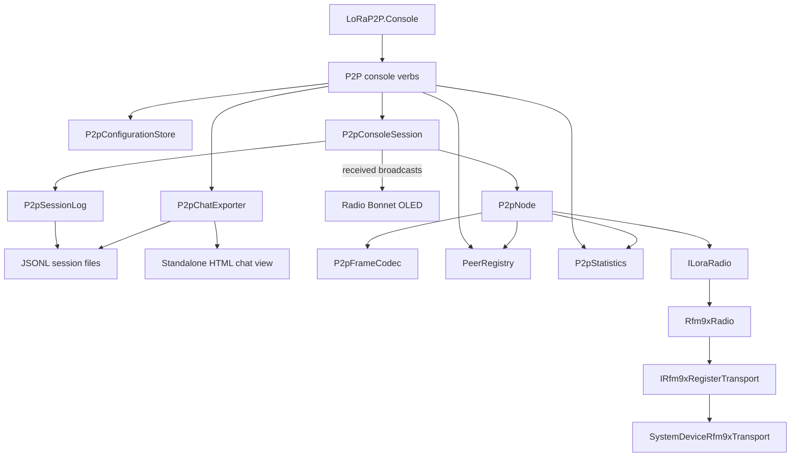
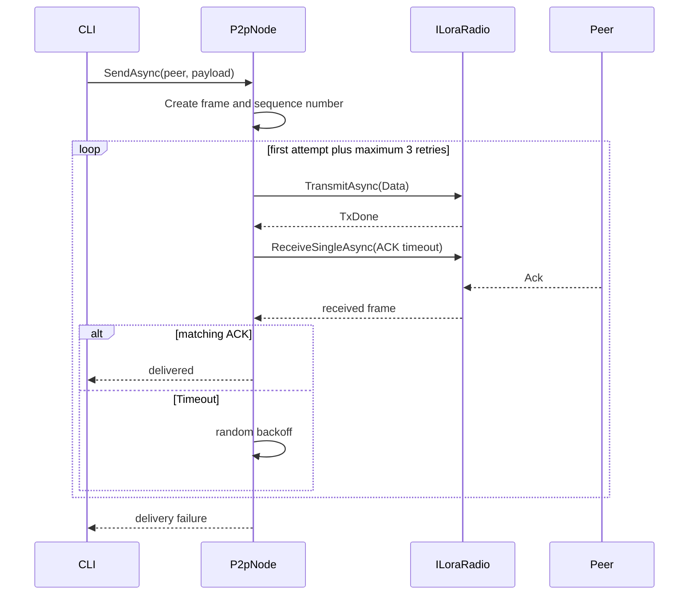

# Target Architecture of the P2P Extension

## 1. Layers

P2P logic is introduced as a separate `LoRaP2P.Protocol` project between the
console and `ILoraRadio`. This keeps the frame format, ACKs, retries, and
duplicate detection independent of CommandLineParser and RFM95 hardware.



## 2. Project Structure

Implemented:

```text
src/
  LoRaP2P.Console/
    Commands/
    P2pConsoleSession.cs
    P2pSessionLog.cs
    P2pChatExporter.cs
  LoRaP2P.Protocol/
    Frames/
    Peers/
    Reliability/
    Statistics/
  LoRaP2P.Radio.Rfm9x/

tests/
  LoRaP2P.Console.Tests/
  LoRaP2P.Protocol.Tests/
  LoRaP2P.Radio.Rfm9x.Tests/
```

Dependencies:

- `LoRaP2P.Protocol` references `LoRaP2P.Radio.Rfm9x` to use `ILoraRadio` and
  the reception models.
- `LoRaP2P.Console` references `LoRaP2P.Protocol`.
- `LoRaP2P.Radio.Rfm9x` knows neither P2P commands nor peer state.
- The frame codec has no hardware or filesystem dependency.

## 3. Core Components

### P2pFrame and P2pFrameCodec

- typed immutable frame model,
- deterministic encoding,
- complete validation during decoding,
- no silent defaults for invalid input.

### P2pNode

Orchestrates half-duplex communication:

- assign sequence numbers,
- send data and broadcasts,
- wait for ACKs,
- perform retries and backoff,
- receive continuously,
- deliver addressed frames,
- generate ACKs,
- suppress duplicates,
- update statistics.

A semaphore protects complete P2P transactions. For addressed transmission,
the lock covers both TX and the subsequent ACK wait phase.

### PeerRegistry

Separates persistent and transient data:

- persistent: local ID and known peer IDs,
- session-specific: last reception, RSSI, SNR, and last sequence numbers.

### P2pStatistics

Thread-safe session counters:

- sent and received data frames,
- sent and received ACKs,
- retries,
- ACK timeouts,
- duplicates,
- CRC errors,
- discarded invalid or foreign-addressed frames,
- delivery failures.

### P2pConfigurationStore

- loads and validates the separate JSON file,
- writes changes atomically through a temporary file and replacement,
- reports I/O and validation errors explicitly,
- stores no keys.

### P2pSessionLog and P2pChatExporter

`P2pConsoleSession` logs sent and received payloads process-wide.
`P2pSessionLog` keeps an append-only JSONL writer open for each combination of
local ID and peer and closes all writers when the process ends. Broadcasts use
a separate pseudo-peer.

`P2pChatExporter` also reads a session file that is still open, validates each
JSON object, and atomically creates a standalone HTML file. Dynamic content is
HTML-encoded; external scripts, fonts, or stylesheets are not loaded.

### Radio Bonnet Display

In normal operation, `P2pConsoleSession` forwards only newly received
broadcast payloads to the OLED. Display rendering is decoupled from radio
reception so that an active display does not block other frames.
`RadioBonnetTextLayout` wraps text at 21 characters per line. With more than
four lines, a background task advances the display one line at a time to the
last page. A new message cancels the previous run.

## 4. Transmission Flow



`TxDone` remains separate from the peer ACK. Only a correctly matched ACK
reports P2P delivery.

## 5. Listen Flow

`listen` repeatedly calls `ReceiveSingleAsync` with a short internal timeout so
that cancellation is observed regularly.

For each received frame:

1. Check the RFM95 CRC.
2. Decode the complete frame.
3. Check addressing.
4. Update statistics and peer metadata.
5. Detect duplicates.
6. Deliver new data to the console.
7. Acknowledge directly addressed data after 100 ms.

Ctrl+C terminates the process. The existing cancellation path restores the
radio standby mode.

## 6. Test Architecture

In addition to the existing `FakeLoraRadio`, protocol tests require a
scriptable fake:

- queue of incoming packets,
- recording of all transmitted frames,
- controllable timeouts and CRC errors,
- deterministic clock through `TimeProvider`,
- deterministic backoff values through an injected random source.

This allows retries and timeouts to be tested without real waiting.
